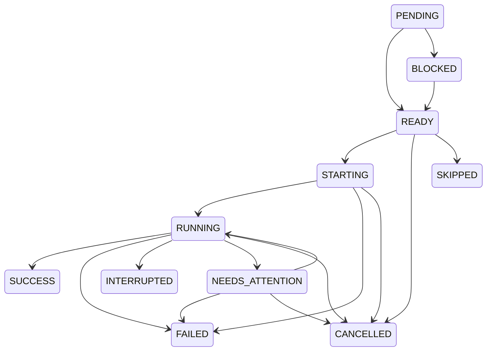

# Codex Flow TaskRun State Machine

This document defines the canonical `TaskRun` state machine. The Scheduler must follow these states and transitions exactly.

## Canonical states

Only these 11 states exist:

`PENDING`, `BLOCKED`, `READY`, `STARTING`, `RUNNING`, `NEEDS_ATTENTION`, `SUCCESS`, `FAILED`, `INTERRUPTED`, `SKIPPED`, `CANCELLED`.

| State | Meaning | Who can enter it | Terminal | Allowed outgoing states |
|---|---|---|---|---|
| `PENDING` | The TaskRun is registered but readiness has not yet been resolved. | Scheduler when a TaskRun is created. | No | `READY`, `BLOCKED` |
| `BLOCKED` | A required dependency prevents the TaskRun from starting. | Scheduler after dependency evaluation. | No | `READY` |
| `READY` | All required dependencies are satisfied and the TaskRun may start. | Scheduler after readiness evaluation; explicit `Resume Workflow` may restore workflow progression. | No | `STARTING`, `CANCELLED`, `SKIPPED` |
| `STARTING` | The Scheduler is initiating execution and has not yet observed running execution. | Scheduler from `READY`. | No | `RUNNING`, `FAILED`, `CANCELLED` |
| `RUNNING` | Execution has started and is in progress. | Scheduler after confirmed execution start. | No | `SUCCESS`, `FAILED`, `INTERRUPTED`, `NEEDS_ATTENTION`, `CANCELLED` |
| `NEEDS_ATTENTION` | Execution requires an explicit intervention before it can continue. | Scheduler when execution reports or enters an attention-required condition. | No | `RUNNING`, `FAILED`, `CANCELLED` |
| `SUCCESS` | The TaskRun completed successfully. | Scheduler only from a Codex terminal completion event, or explicit `Mark Success`. | Yes | None |
| `FAILED` | The TaskRun completed unsuccessfully or could not be started. | Scheduler from an execution failure, or explicit manual action where permitted. | Yes | None |
| `INTERRUPTED` | Execution stopped before confirmed successful completion. | Scheduler when execution is interrupted. | Yes | None |
| `SKIPPED` | The TaskRun was intentionally omitted by an explicit action. | Explicit `Skip` action. | Yes | None |
| `CANCELLED` | The TaskRun was explicitly cancelled. | Explicit `Cancel` action or Scheduler cancellation during an active transition. | Yes | None |

No state outside this set may be introduced. Terminal states do not automatically execute again. `Retry` is an explicit action and creates a new execution Attempt; it does not add an outgoing transition from a terminal state.

## Transition table

| From | To | Trigger / rule |
|---|---|---|
| `PENDING` | `READY` | Dependency readiness is satisfied. |
| `PENDING` | `BLOCKED` | A required dependency is terminal but not `SUCCESS`. |
| `BLOCKED` | `READY` | Required dependencies later become satisfied. |
| `READY` | `STARTING` | Scheduler begins execution. |
| `READY` | `CANCELLED` | Explicit `Cancel`. |
| `READY` | `SKIPPED` | Explicit `Skip`. |
| `STARTING` | `RUNNING` | Execution start is confirmed. |
| `STARTING` | `FAILED` | Starting fails. |
| `STARTING` | `CANCELLED` | Explicit `Cancel`. |
| `RUNNING` | `SUCCESS` | Codex terminal completion event confirms success. |
| `RUNNING` | `FAILED` | Codex terminal completion event confirms failure. |
| `RUNNING` | `INTERRUPTED` | Execution is confirmed interrupted. |
| `RUNNING` | `NEEDS_ATTENTION` | Execution requires intervention. |
| `RUNNING` | `CANCELLED` | Explicit `Cancel`. |
| `NEEDS_ATTENTION` | `RUNNING` | Explicit intervention permits continuation. |
| `NEEDS_ATTENTION` | `FAILED` | Explicit intervention records failure. |
| `NEEDS_ATTENTION` | `CANCELLED` | Explicit `Cancel`. |

## Dependency readiness rule

For a TaskRun with dependencies:

```text
all dependencies SUCCESS
→ READY
```

A TaskRun with no dependencies:

```text
→ READY
```

If any required dependency is `FAILED`, `INTERRUPTED`, `CANCELLED`, or `SKIPPED`, the downstream TaskRun:

```text
→ BLOCKED
```

`SKIPPED != SUCCESS`. A skipped dependency does not satisfy a requirement for `SUCCESS`.

## Fail-closed rule

If the Scheduler cannot determine whether an external Task has safely completed:

```text
do not release downstream tasks
```

The Scheduler must not guess that the external Task succeeded. Ambiguous external state remains non-releasing until a definitive completion result is observed.

## Manual overrides and audit

The following are explicit human actions:

`Retry`, `Cancel`, `Skip`, `Mark Success`, `Pause Workflow`, `Resume Workflow`.

`Skip` and `Mark Success` must each produce an audit event. `Mark Success` may unlock downstream tasks that require `SUCCESS`. `Skip` does not, by default, unlock downstream tasks that require `SUCCESS`.

`Pause Workflow` and `Resume Workflow` control workflow progression; they do not add TaskRun states or transitions. `Retry` creates a new execution Attempt. Terminal states are not automatically retried.

## Completion source

Technical task completion can come only from:

```text
Codex terminal completion event
```

The following are not completion sources:

```text
timeout elapsed
UI button disappeared
assistant text says done
LLM believes it finished
```

## State diagram


